# Global Electronics Retailer — End-to-End Analytics on Microsoft Fabric

An end-to-end data engineering and analytics project built on **Microsoft Fabric** using the **Medallion Architecture** (Bronze → Silver → Gold). Raw CSV extracts from a fictitious global electronics retailer are ingested, validated, cleaned, modelled into a star schema and orchestrated by a monitored, failure-aware pipeline, and reported through a Direct Lake Power BI model and a 4-page report.

> **Status:** Complete: Bronze, Silver, Gold, orchestration and logging, semantic model and Power BI report

---

## Business problem

The retailer sells electronics through 66 physical stores in 8 countries and an online store, in 5 currencies. Leadership needs trustworthy answers to:

- How are revenue, profit and margin trending, and how do we compare years fairly when the latest year is incomplete?
- Which product categories, countries and stores drive revenue and profit?
- How does the online channel perform, including delivery times?
- What do sales look like in each local currency vs. USD?

The data arrives as **five separate CSV extracts** with mixed encodings, money stored as text and implicit business rules, which is typical of real client data.

---

## Architecture

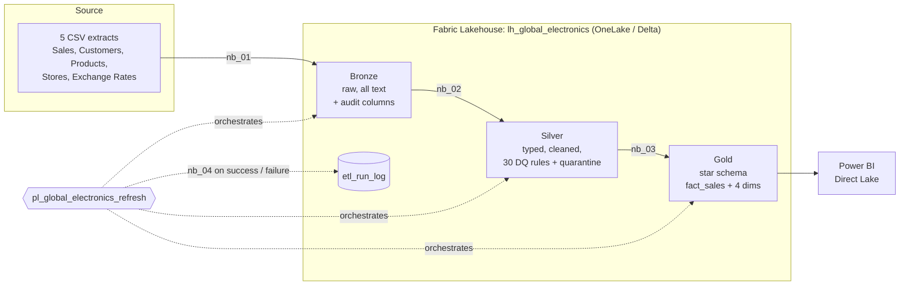

| Layer | Notebook | Output tables | Purpose |
|---|---|---|---|
| Bronze | `nb_01_bronze_ingest` | `bronze_sales`, `bronze_customers`, `bronze_products`, `bronze_stores`, `bronze_exchange_rates` | Replayable copy of the source, unchanged |
| Silver | `nb_02_silver_transform` | `silver_*` (5 tables), `silver_dq_rejects`, `silver_dq_results` | Typed, standardised, validated data |
| Gold | `nb_03_gold_model` | `fact_sales`, `dim_date`, `dim_customer`, `dim_product`, `dim_store` | Analytics-ready star schema |
| Logging | `nb_04_log_run` | `etl_run_log` | One audit row per pipeline run |

**Tech stack:** Microsoft Fabric (Lakehouse, OneLake, Notebooks, Data Pipelines, SQL analytics endpoint), PySpark (Spark 4.x runtime), Delta Lake, Spark SQL / T-SQL, Power BI (Direct Lake semantic model, DAX).

---

## Dataset

[Maven Analytics – Global Electronics Retailer](https://mavenanalytics.io/data-playground/global-electronics-retailer) (fictitious data). The raw files are not committed to this repo; download them from Maven.

| File | Rows | Grain | Notable issues found during profiling |
|---|---|---|---|
| Sales.csv | 62,884 | order line | Delivery date blank for all in-store sales (business rule, not missing data) |
| Customers.csv | 15,266 | customer | **Windows-1252 encoding**, not UTF-8; 25% of city names in ALL CAPS; alphanumeric Canadian postcodes |
| Products.csv | 2,517 | product | Prices stored as text (`"$2,899.99 "`); keys with leading zeros (`0101`); `"` inside names |
| Stores.csv | 67 | store | Store 0 = Online (no floor size) |
| Exchange_Rates.csv | 11,215 | date × currency | Daily rates for USD, CAD, AUD, EUR, GBP |

Full profile: [`docs/data_profile.md`](docs/data_profile.md)

---

## Layer details

### Bronze: metadata-driven ingestion
- **One config list + one loop** loads all five files; adding a source means adding one line.
- **Per-file encoding.** Customers needs Windows-1252; a single global setting would corrupt either it or Stores (UTF-8).
- **Schema contract:** the run fails if an expected column disappears, and warns if a new one appears.
- **Independent reconciliation:** Spark row count vs. raw line count from the file. All 5 tables: PASS.
- Columns renamed to `snake_case` (Delta doesn't allow spaces). **Values untouched, everything kept as text.**
- Audit columns `_source_file`, `_ingested_at`, `_batch_id`; full overwrite, so reruns never duplicate data.

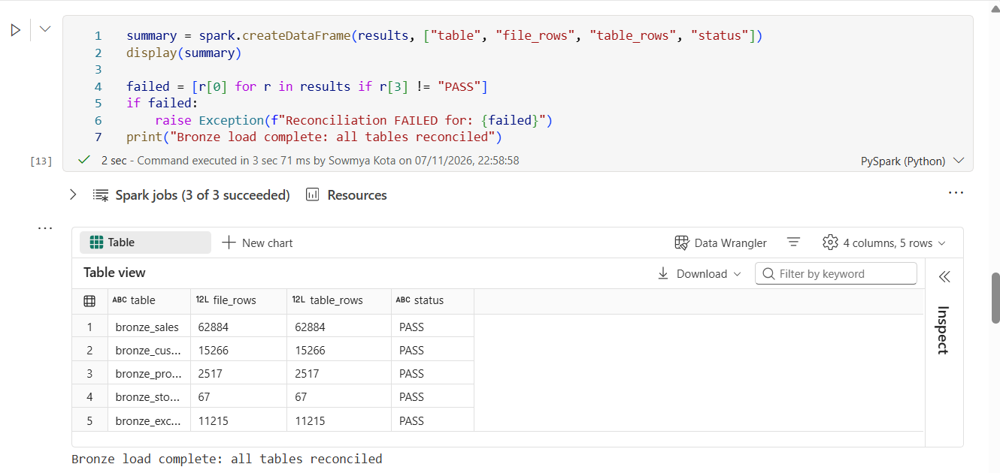

### Silver: cleaning and a reusable data-quality framework
- Safe parsing (`try_to_timestamp`, `try_cast`): bad values become NULL and are **caught by DQ rules** instead of crashing the job.
- Money as `DECIMAL(10,2)` (not float); exchange rates `DECIMAL(18,6)`; leading-zero keys and postcodes stay text.
- City names title-cased **only when stored in ALL CAPS** (mixed-case names left untouched).
- **30 DQ rules** across 5 tables with two severities ([full list](docs/data_quality_rules.md)):
  - `error` → row is quarantined to `silver_dq_rejects` with the rule names and original raw record.
  - `warning` → row is kept and the count is logged.
- **Referential integrity:** every sale must match a valid customer, product, store and an exchange rate for its order date and currency.
- Per-rule results are appended to `silver_dq_results` every run (DQ history).
- **Reject-rate gate** (parameter `max_reject_pct`, default 1%): the run fails if exceeded, after saving the rejects for investigation.
- **Negative testing:** the real data is clean (0 rejects), so the rules were proven with deliberately broken records. 5 out of 5 were caught with the correct reason.

| DQ gate: 0% rejected across all tables | Business rule check: online vs in-store delivery |
|---|---|
| 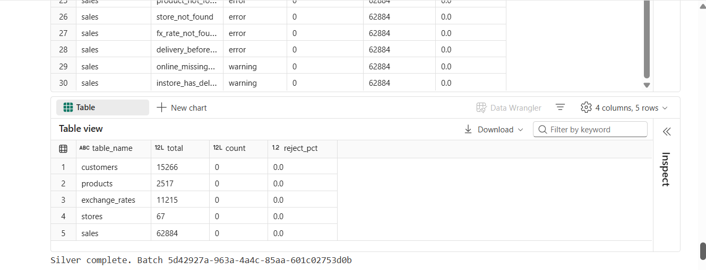 | 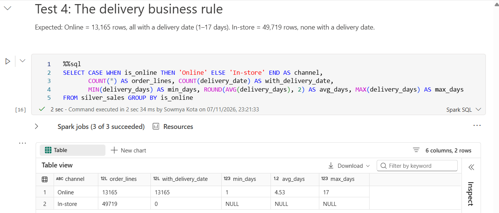 |

### Gold: star schema

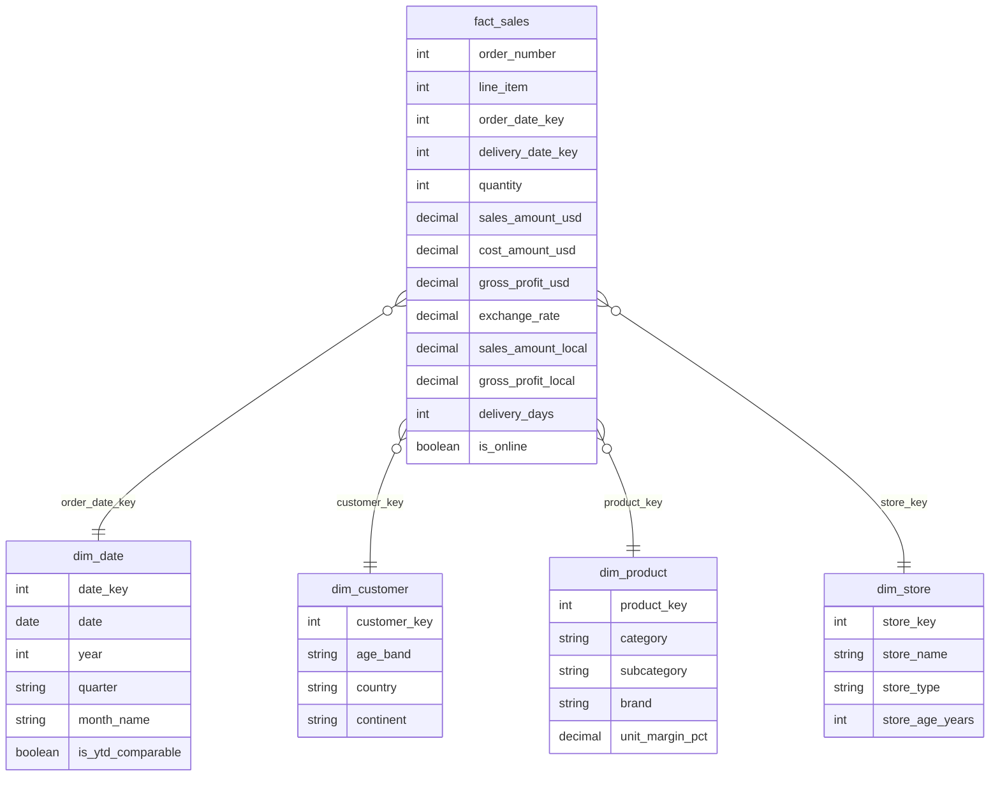

- **Grain:** one row per order line (62,884 rows).
- **Currency rule:** product prices are already in USD, so `sales_amount_usd = quantity × unit_price_usd`. The exchange rate is *local currency per 1 USD* on the order date, so `sales_amount_local = USD × rate`. It's converted **once** in Gold, so every report uses identical figures.
- **Like-for-like flag** `dim_date.is_ytd_comparable`: the data ends on 20 Feb 2021, and this flag enables fair year-over-year comparisons (see insights).
- Natural keys / SCD Type 1: there's one stable source system and no requirement to track history. SCD2 with surrogate keys would be the next step if history were needed.
- **15-check quality gate**, including an **independent revenue reconciliation**: Gold revenue (computed in PySpark) = Silver revenue (recomputed in SQL) = **$55,755,479.59**.

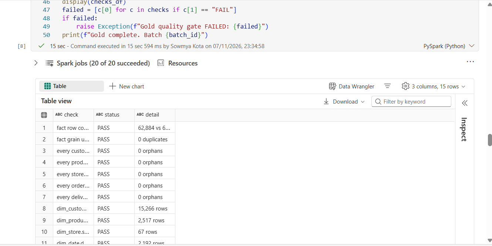

### Orchestration and logging

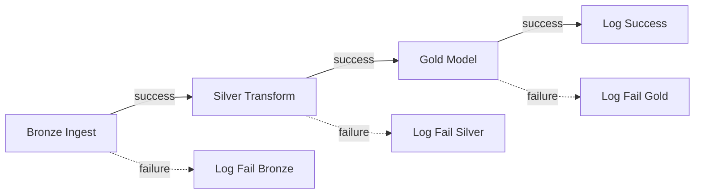

- Pipeline `pl_global_electronics_refresh` chains the three notebooks with success dependencies.
- **One failure branch per notebook.** Fabric combines multiple incoming dependencies with AND, so a single shared failure activity would never run.
- **Error capture:** `@activity('<name>').error.message` and `@pipeline().RunId` are passed to `nb_04_log_run`, which writes to `etl_run_log` (status, failed stage, error message, row counts per layer, DQ rejects).
- After logging a failure, the notebook re-raises it, so the run still shows **Failed** in Monitor.
- **Retries** (2 × 120 s) handle transient Spark capacity errors (HTTP 430).
- **Idempotent logging:** retries re-run the log step, so it skips the write if that run's outcome is already logged.
- **Failure path tested** by injecting `max_reject_pct = -1` as a pipeline parameter (no code change). Silver failed, Gold was skipped, and exactly one `Failed` row was logged even though the log step ran 3 times.
- Scheduling: not enabled. The source data is static and the Fabric trial capacity is limited; in production this would run on a daily schedule trigger.

**Pipeline design**

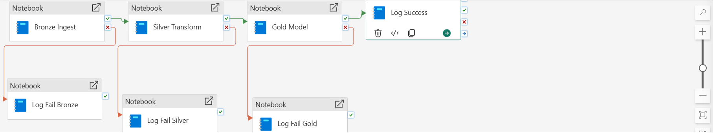

**Successful run** (Gold's first attempt hit a capacity error; the retry succeeded)

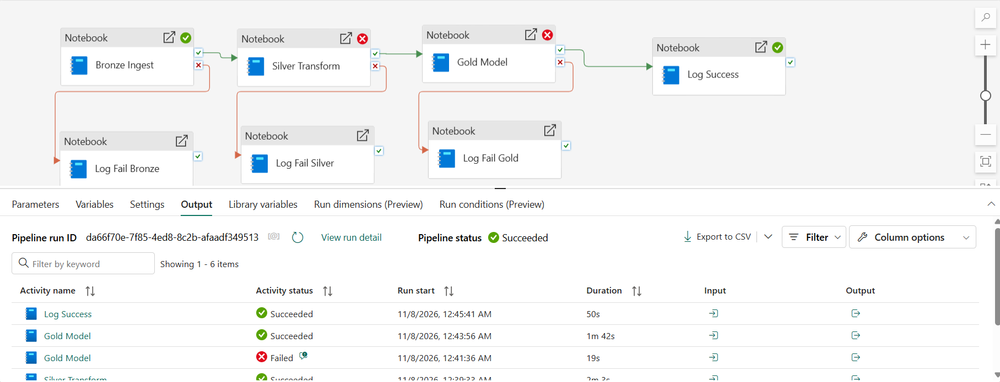

**Failure test:** Silver failed by design, Gold was skipped, and the failure was logged once despite retries

| Failure-test run | Audit log (`etl_run_log`, times in UTC) |
|---|---|
| 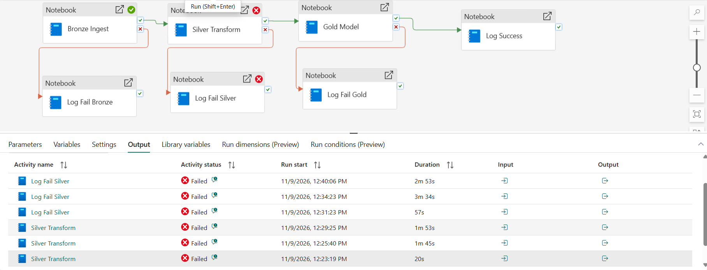 | 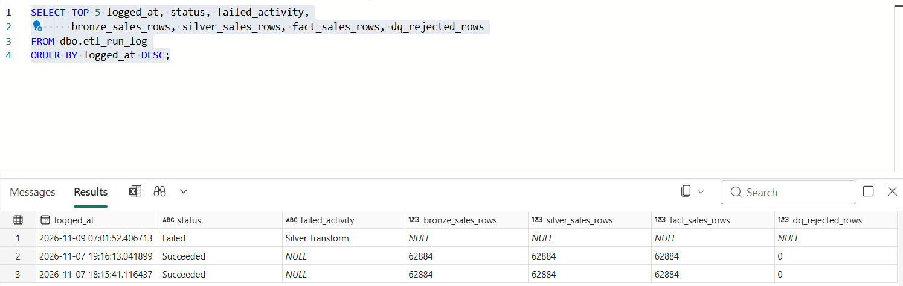 |

Details: [`pipeline/README.md`](pipeline/README.md)

---

## Results and insights (from the Gold layer)

| Metric | Value |
|---|---|
| Total revenue (2016 – 20 Feb 2021) | **$55.76M** |
| Gross margin | **~58.5%**, stable every year |
| Orders / order lines | 26,326 / 62,884 |
| Top category | Computers, $19.3M |
| Online delivery time | 1–17 days, avg **4.53 days** |

**Avoiding a misleading year-over-year comparison.** A full-year chart shows 2021 revenue falling from $9.29M to $1.04M (**–89%**). But 2021 data only runs to **20 February**. Comparing the same 1 Jan – 20 Feb window each year:

| Year | Revenue 1 Jan – 20 Feb |
|---|---|
| 2019 | $3.32M |
| 2020 | $3.49M |
| 2021 | $1.04M |

The real decline is **–70%**, and early 2020 was actually *stronger* than early 2019, so the 2020 drop happened later in the year.

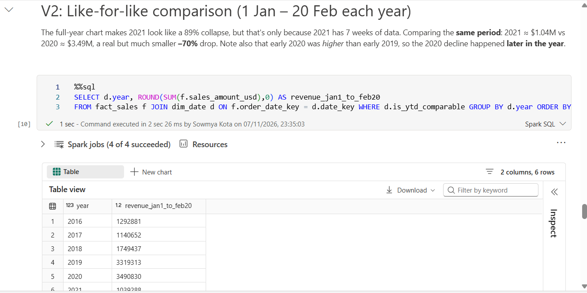

---

## Power BI: semantic model and report

### Semantic model (`sm_global_electronics`)
- **Direct Lake** on the Gold Delta tables: import-like performance with no data copy; the report reflects each pipeline refresh.
- Star schema relationships: many-to-one, single direction, from `fact_sales` to the 4 dimensions.
- **Role-playing date:** `order_date_key → dim_date` is active; `delivery_date_key → dim_date` is inactive and used only through `USERELATIONSHIP`.
- **No calculated columns:** derived attributes (age band, store name, like-for-like flag, sort keys) were built in the Gold notebook, keeping the model fully Direct Lake-compatible.
- **25 measures** in 4 display folders, each tested in DAX query view against independently computed values. Raw amount and key columns are hidden, so reports use the tested measures (one version of the truth).
- Full list with business questions and the traps each measure avoids: [`powerbi/dax_measures.md`](powerbi/dax_measures.md)
- Full model definition (tables, columns, relationships, measure formats and folders, RLS), exported from Fabric: [`powerbi/semantic_model.md`](powerbi/semantic_model.md)

### Report (`rpt_global_electronics`)

| Page | Business question | Key finding |
|---|---|---|
| Executive Overview | How are we doing overall? | $55.76M revenue, 58.6% margin; naive 2021 YoY –89% vs like-for-like –70% |
| Growth & Mix | Why did order value fall? | Orders ×3.2 (2016→2019) but AOV –17%: items per order flat, mix shifted to cheaper categories |
| Channel & Delivery | Is online worth it? When did 2020 turn down? | Online share 17% → 27%; delivery 7.3 → 3.8 days; both channels fell from May 2020 |
| Stores & Markets | Which stores and markets perform? | Canada ($750/m²) and the US lead; 9 stores never traded, 5 closed mid-period |

Design choices: action titles that state the insight, one accent colour for the focus series with grey for context, axes and data bars starting at zero, and data caveats on the page.

| | |
|---|---|
| 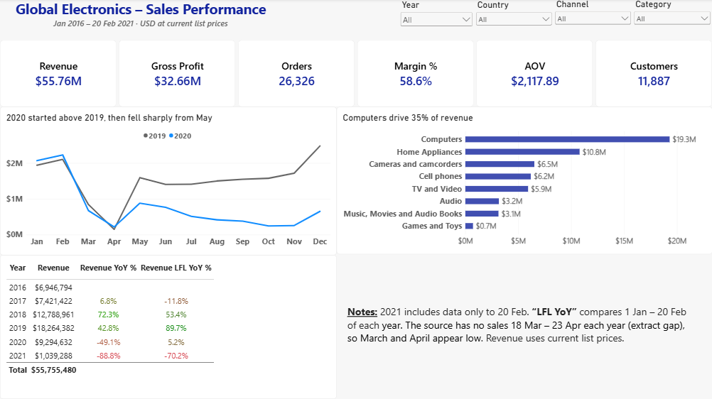 | 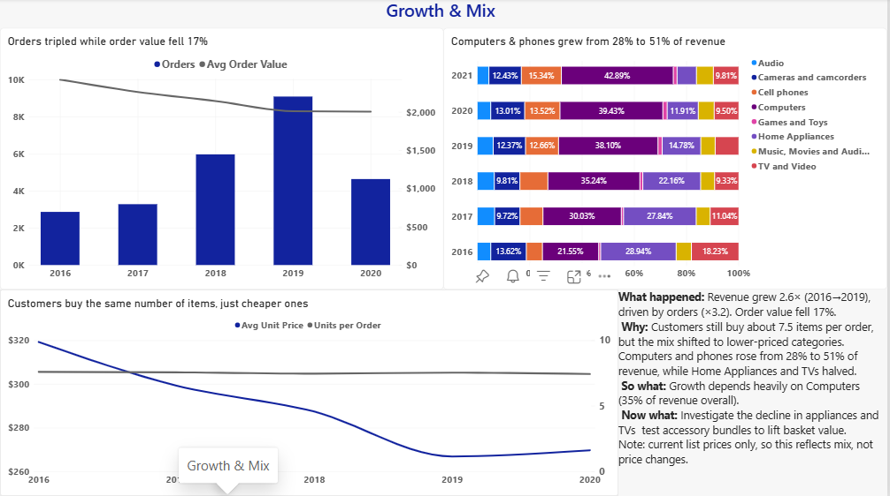 |
| 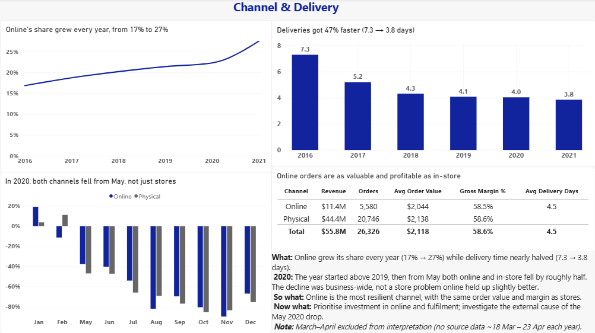 | 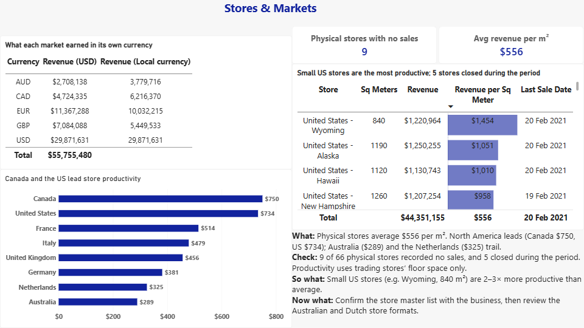 |

### Row-level security (RLS)
A **Country Manager** role restricts the model to one country's customers with a rule on `dim_customer`:

```dax
[country] = "Germany"
```

- **Design choice:** filtering by *customer* country rather than *store* country includes online orders from German customers ($1.17M). A store-based rule would have missed them, because the Online store has no country. The right definition depends on the business, so it should be confirmed with stakeholders.
- The filter flows from `dim_customer` to `fact_sales` through the relationship, so every measure and page is restricted.
- **Validation:** *Test as role* is not supported when Direct Lake uses Single Sign-On, so the rule was validated in DAX query view with the same filter:

```dax
EVALUATE
CALCULATETABLE (
    ROW ( "Revenue", [Revenue], "Orders", [Orders], "Customers", [Customers], "Online Revenue", [Online Revenue] ),
    dim_customer[country] = "Germany"
)
```

| | All data | Country Manager (Germany) |
|---|---|---|
| Revenue | $55,755,480 | $5,414,150 |
| Orders | 26,326 | 2,440 |
| Customers | 11,887 | 1,150 |
| Online revenue | $11,404,325 | $1,167,871 |

RLS applies to users with Viewer access; workspace admins still see all data. A full impersonation test would require switching the model to a fixed-identity connection.

### Data issue found while reporting
The source contains **no sales between ~18 March and ~23 April in every year** (2016–2020), almost certainly an extract gap. Row-level DQ rules can't detect missing periods, so it surfaced only in the monthly trend. The report annotates it and excludes March–April from month-level YoY; the pipeline roadmap includes a date-coverage check.

---

## Engineering challenges solved

| Challenge | What happened | Resolution |
|---|---|---|
| Mixed file encodings | Customers.csv is Windows-1252; Fabric's Spark 4 runtime rejects that charset name by default | Profiled the bytes: ISO-8859-1 would silently corrupt 74 characters (e.g. *Miloš*). Enabled `spark.sql.legacy.javaCharsets` instead and verified the names |
| Spark capacity limits (HTTP 430) | Each notebook activity starts its own Spark session; the trial capacity rejected new sessions | Diagnosed from the run output; added retry policies; stopped idle interactive sessions |
| Failure logging that couldn't log | The failure-log step hit the same capacity limit, so failures weren't recorded | Added retries to the log steps and made the logging idempotent |
| Misleading visuals | A narrow secondary axis made a flat metric (units per order, 7.4–7.6) look volatile | Axes and data bars start at zero; chart shape now matches the real size of the change |
| Blind retries | Retries also re-run deterministic failures (e.g. the DQ gate) | Documented trade-off; next step: separate data failures from infrastructure failures |

More: [`docs/lessons_learned.md`](docs/lessons_learned.md)

---

## Assumptions and limitations

- Revenue uses **current list prices**; the source has no historical prices or discounts.
- Ages and store ages are calculated as of the last sales date (20 Feb 2021) so results are reproducible.
- Full reloads (overwrite) suit this data volume; at scale, the next step would be incremental loads with Delta `MERGE`.

---

## Repository structure

```
├── notebooks/
│   ├── nb_01_bronze_ingest.ipynb
│   ├── nb_02_silver_transform.ipynb
│   ├── nb_03_gold_model.ipynb
│   └── nb_04_log_run.ipynb
├── pipeline/          # pipeline design + exported JSON
├── sql/               # validation and analysis queries
├── powerbi/           # DAX measures + exported semantic model definition
├── docs/              # data profile, DQ rules, lessons learned
└── images/            # screenshots from the Fabric workspace
```

## How to reproduce

1. Create a Fabric workspace and a Lakehouse (`lh_global_electronics`).
2. Upload the 5 CSVs to `Files/raw/global_electronics/`.
3. Import the four notebooks and attach the Lakehouse to each.
4. Run `nb_01` → `nb_02` → `nb_03` (or build the pipeline described in `pipeline/README.md`).
5. Validate with the queries in `sql/validation_queries.sql`.
6. Create a semantic model from the 5 Gold tables (Direct Lake), add the relationships above, and the measures in `powerbi/dax_measures.md`.

## Roadmap

- [x] Power BI semantic model (Direct Lake) with DAX measures
- [x] Report: revenue trends, like-for-like YoY, category/region/store performance, online delivery
- [x] Row-level security (Country Manager role)
- [ ] Dynamic RLS (one role, filtered by the signed-in user's email)
- [ ] Date-coverage DQ check (flag runs of more than 7 days with no sales)
- [ ] Separate data-quality failures from infrastructure failures for smarter retries
